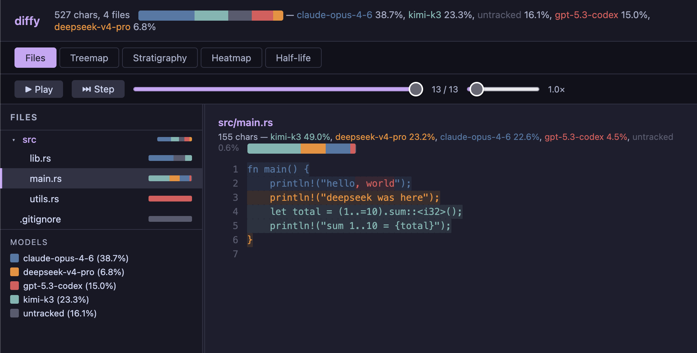

# diffy-ai-analysis

[](https://github.com/computerchale/diffy-ai-analysis/actions/workflows/ci.yml)

Character-level provenance for AI-written code.



Like assaying a metal — know the chemical composition of your codebase: which model wrote which characters, in which session, and how much of each model's work survives today.

> **Status: early, Cursor-only.** Automatic capture currently works only in [Cursor](https://cursor.com), through its `afterFileEdit` hook. diffy depends on the shape of that hook's payload (`file_path`, `edits`, `model`, `conversation_id`), which Cursor doesn't document as a stable API and may change. If it does, capture stops — silently, because the hook never blocks the editor — until diffy is updated. A report would then show the missed edits as untracked drift. Other agents can still send edits to `diffy hook` in diffy's own format (see [Other editors](#other-editors)), but no other integration ships yet.

## Requirements

- **Rust 1.88 or newer**, to build and install.
- **git**: diffy stores everything as git objects and shells out to the `git` CLI.
- **Cursor**: capture currently comes from Cursor's `afterFileEdit` hook. Other agents can feed `diffy hook` directly (see [Other editors](#other-editors)).
- **bash**, used by the generated hook script. Nothing else: diffy reads Cursor's payload itself.
- **jq** (optional): only used to pretty-print JSON in the [Debugging](#debugging) examples. diffy and its hook don't need it.

macOS and Linux are supported. Windows hasn't been tested.

## Quick start

The package is `diffy-ai-analysis`; the installed command is `diffy`.

```bash
# Install
git clone https://github.com/computerchale/diffy-ai-analysis.git
cd diffy-ai-analysis
cargo install --path . --locked
command -v diffy   # should print ~/.cargo/bin/diffy; if not, add ~/.cargo/bin to PATH

# Initialize in a git repo (installs Cursor hooks automatically)
diffy init --repo /path/to/your/repo

# If the repo is a subfolder of your Cursor workspace:
diffy init --repo /path/to/repo --workspace /path/to/workspace

# Check the setup (exits 1 if anything would stop edits being recorded):
diffy doctor --repo /path/to/your/repo

# From now on, AI agent edits in Cursor are captured automatically.
# Check composition:
diffy comp --repo /path/to/your/repo

# Generate an HTML report:
diffy report --repo /path/to/your/repo
```

Run `init` with the installed `diffy`, not a binary in a `target/` folder. The hook script calls whichever binary ran `init`, by its full path. A `target/` binary goes missing on `cargo clean` and changes whenever you rebuild. If that path does go missing, the hook falls back to `diffy` on `PATH`.

### Updating

```bash
cd diffy-ai-analysis
git pull
cargo install --path . --locked --force   # rebuilds and replaces ~/.cargo/bin/diffy
diffy doctor --repo /path/to/your/repo
```

`--force` reinstalls even if Cargo thinks the installed copy is current, which happens when the code changed but the version number didn't. You don't need to rerun `init`, because the hook picks up the new binary on the next edit. The exception is when `doctor` reports `hook script: … differs from what this diffy generates`. The new version then generates a different hook script, so rerun `init` with `--force`, using the same `--repo` and `--workspace` as before, in each workspace.

To move an existing setup from a `target/` binary to the installed one, run `cargo install` as above, then `diffy init --repo … --workspace … --force`.

## How it works

Every time an AI agent edits a file in Cursor, diffy captures:

1. **What changed** — full before/after file content, stored as git blobs
2. **Who changed it** — exact model slug (e.g. `claude-opus-4-6`, `gpt-5.3-codex`, `kimi-k3`)
3. **Which session** — conversation ID from Cursor's payload

All data lives inside the git repo as refs (`refs/provenance/events/*`) and blobs — your branches are never touched. See [SPEC.md](SPEC.md) §5 for the full storage design.

> **Make sure your `.gitignore` is right before using diffy.** diffy stores a full snapshot of every file an AI agent edits, unless git ignores that file. Files matched by `.gitignore` (like `.env` or `build/`) are skipped: nothing is stored, and a warning naming the path goes to the [hook log](#check-the-hook-log). **Anything not ignored is captured**, including secrets in files you forgot to list. Those snapshots stay in `refs/provenance/*` even if you later delete the secret from the file. They aren't pushed by a normal `git push`, only if you push those refs explicitly. Files that are tracked despite matching an ignore pattern (added with `git add -f`) are captured, the same as git treats them.

The replay engine rebuilds provenance by replaying the event log through a piece table, computing char-level diffs between consecutive snapshots. For every edit the hook captured, this gives exact per-character attribution — not line-level, not heuristic.

diffy only sees edits that come through the hook. Changes made by hand, by other tools, or while the hook wasn't working aren't recorded as anyone's work, and diffy never guesses who made them. They show up as untracked (gray) in two ways:

- **Between AI edits:** when the next AI edit arrives and the file no longer matches its last recorded state, diffy first records the difference as `untracked`. The AI is then credited only with its own change.
- **After the last AI edit:** the report compares the replayed file with what's on disk and marks the difference as untracked drift.

## Commands

Only `doctor` needs `init`. The other commands read the provenance refs in the repo, so they also work on a repo where `init` never ran, such as a clone that came with its refs. They do need a git repo. Outside one (a wrong `--repo`, or the wrong folder), they exit 1 with `<path> is not a git repository`, rather than reporting that nothing was recorded. A subfolder of a repo works, the same as with git.

### `diffy init`

```bash
diffy init --repo .                         # current dir
diffy init --repo ./myrepo --workspace .    # repo is subfolder of workspace
diffy init --repo . --force                 # reinstall over an existing setup
```

Existing hooks in `.cursor/hooks.json` are kept. `init` stops with an error and changes nothing if diffy is already set up, or if `hooks.json` isn't valid JSON or has an unexpected shape. `--force` reinstalls diffy's hook; an unmergeable `hooks.json` is replaced, with the old file saved as `hooks.json.bak`.

Verifies the target is a git repo, then installs a Cursor `afterFileEdit` hook that captures each AI agent edit Cursor reports. The hook is a small bash script at `.cursor/hooks/diffy-hook.sh` that pipes Cursor's payload to `diffy hook --cursor`.

### `diffy doctor`

```bash
diffy doctor --repo .                         # same workspace lookup as init
diffy doctor --repo ./myrepo --workspace .
```

Checks that capture is set up and working, and changes nothing. It prints one line per check, each with a fix, and exits 1 if any check fails. Warnings don't affect the exit status.

```
ok    git: git version 2.48.1
ok    repo: /Users/me/project
ok    hooks.json: /Users/me/project/.cursor/hooks.json
warn  hook script: /Users/me/project/.cursor/hooks/diffy-hook.sh differs from what this diffy generates (older version or edited) — run `diffy init --force`
fail  diffy binary: /Users/me/diffy/target/release/diffy is gone and there's no diffy on PATH, so edits aren't being recorded — `cargo install --path .`, then `diffy init --force`
ok    hook log: no problems logged
ok    fallback log: no problems logged
ok    events: 166 event(s), latest 2026-10-27T16:13:24Z (src/main.rs)
ok    event paths: all repo-relative
```

It checks git, the repo, the `hooks.json` entry, and whether the hook script exists, is executable and is current. It also checks that the diffy binary baked into the script still exists, or that there's a `diffy` on `PATH` to fall back to. Finally it checks both hook logs, how many events are recorded, and whether any event has a path that isn't repo-relative (older diffy versions could record those). `PATH` here is your shell's, which may differ from the one Cursor gives the hook.

### `diffy hook`

```bash
# Called automatically by the Cursor hook — you rarely run this manually.

# Cursor native format (afterFileEdit payload via stdin). Without --repo,
# diffy uses the git repo that contains file_path:
echo '{"file_path":...,"edits":[...],"model":"..."}' | diffy hook --cursor --payload @-

# diffy native format (full before/after content):
diffy hook --repo /repo --payload '{"model":"opus","path":"src/main.rs","before":"...","after":"..."}'

# From a file:
diffy hook --repo /repo --payload @/tmp/payload.json
```

The hook script ignores `diffy hook`'s exit status so it never blocks Cursor. Instead, every error (edit not recorded) and warning (file skipped because git ignores it, or edit recorded as `untracked` because it couldn't be placed) is appended to `.git/diffy/hook.log`. Problems that happen before diffy knows the repo go to `~/.local/state/diffy/hook.log` (or `$XDG_STATE_HOME/diffy/hook.log`). Examples are the diffy binary not being found, or a payload with no `file_path`. See [Check the hook log](#check-the-hook-log).

### `diffy comp`

```bash
diffy comp --repo .                # whole repo composition
diffy comp --repo . src/           # just files under src/
diffy comp --repo . --json         # machine-readable output
```

Output:
```
(entire repo)  (672 chars, 2 files)

  claude-opus-4-6            55.1%  (370 chars)
  kimi-k3                    24.1%  (162 chars)
  gpt-5.2                    20.8%  (140 chars)
```

If `.git/diffy/hook.log` has entries, `comp` first prints a one-line notice on stderr, so `--json` output stays clean:

```
warning: 2 hook problem(s) logged in /repo/.git/diffy/hook.log — some edits may not have been recorded. Delete the file to clear this notice.
```

### `diffy report`

```bash
diffy report --repo .                           # writes diffy-report.html, opens in browser
diffy report --repo . --out my-report.html      # custom output path
diffy report --repo . --json                    # raw JSON to stdout
diffy report --repo . --no-session              # omit session/conversation ids (privacy)
diffy report --repo . --modules --json         # module-level provenance to stdout
diffy report --repo . --modules --out modules.json  # module-level provenance to file
```

Like `comp`, `report` prints the hook-log notice on stderr when `.git/diffy/hook.log` has entries.
    
Generates a self-contained HTML file with:
- **File explorer** (left pane) — per-file composition bars
- **Character grid** (right pane) — every character colored by its authoring model
- **Playback controls** — play/pause, timeline scrubber, speed slider (0.1×–20×)
- **Drift detection** — files edited while the hook was broken show untracked chars in gray
- **Session tooltip** — hovering a character shows its authoring model and the originating Cursor conversation id (the raw `conversation_id` from the hook payload)

The `--no-session` flag strips session/conversation ids from the report entirely — useful when you don't want conversation identifiers leaving the machine (e.g. a report you're about to share). Without it, the ids are embedded so a span can be traced back to its chat.

With `--modules`, diffy emits a **module-level provenance report** instead of the per-file/char payload. Each file is mapped to its nearest package manifest (Cargo.toml, package.json, go.mod, pyproject.toml, setup.py), and composition/drift are aggregated per module. The output is a stable, versioned JSON schema (`diffy-modules/1.0`) designed for consumption by downstream tools. `--modules` requires exactly one of `--json` (stdout) or `--out <file>`; using both or neither is an error.

### `diffy blame`

```bash
diffy blame --repo . src/main.rs
```

Line-level annotated source view (§7). Joins `git blame --porcelain` with `refs/notes/provenance` to show which model authored each line. Lines without a provenance note (pre-instrumentation history or human edits) are marked `untracked` — attribution is never guessed.

```
     1  deepseek-v4-pro          fn main() {
     2  deepseek-v4-pro              println!("hello");
     3  untracked                   // added by hand
```

### `diffy why`

```bash
diffy why --repo . src/main.rs:120
```

Answers "which model and session wrote this line?" for a single `file:line` (§12). Prompt text is **not** shown — prompt capture is deferred (neither Cursor's hook payload nor the diffy-native payload carries prompt text today; see SPEC §3/§11).

```
src/main.rs:120
  model:   deepseek-v4-pro
  session: 01J...
```

### `diffy half-life`

```bash
diffy half-life --repo .              # survival curve, all models combined
diffy half-life --repo . --model deepseek-v4-pro
```

Temporal analytics (§8): buckets emitted characters by age and plots how much survives today, then computes the half-life — the age at which survival drops below 50%.

```
(all models): code survival curve
  age_days  survival
         0  1.000
         1  0.741
         2  0.580
         7  0.212
  half-life: 2 days
```

### `diffy checkpoint`

```bash
diffy checkpoint --repo .
```

Binds recorded events to the current `HEAD` commit by writing a git note in the git-ai `authorship/3.0.0` format (§3, §5). This is what makes `diffy blame` work: the note carries the session-to-model mapping for each file's line ranges.

## Running tests

```bash
cargo test              # all 200 tests
cargo test -- --nocapture   # with stdout output
cargo test replay       # just replay engine tests
cargo test capture      # just capture/hook tests
cargo test store        # just storage layer tests
cargo test git          # just git plumbing tests
cargo test payload      # just CLI payload reader tests
cargo test blame        # just blame-join tests
cargo test stats        # just half-life/affinity tests
cargo test report       # just report (drift, escaping, exclusions) tests
```

Tests use real git repos in tempdirs — no mocks. Every test name cites the spec section it validates (e.g. `replay_preserves_spans_through_partial_edit_6_1` → SPEC.md §6.1).

## Debugging

Start with `diffy doctor --repo .`. It covers the common setup problems below.

### Check the hook log

The hook never blocks Cursor, so `diffy hook` writes every error and warning to `.git/diffy/hook.log` instead of failing loudly. `diffy comp` and `diffy report` print a notice while that file has entries:

```bash
cat .git/diffy/hook.log
# 2026-10-27T15:05:36Z warning src/lib.rs: couldn't place 1 edit(s) from conversation … ; recorded as untracked
# 2026-10-27T15:05:36Z warning skipped .env: ignored by git
# 2026-10-27T15:05:36Z error failed to parse Cursor hook payload JSON: missing field `model` …

rm .git/diffy/hook.log   # clears the notice
```

A `warning` is one of two things:

- **`skipped <path>: ignored by git`** — deliberate. The file matches `.gitignore`, so nothing was stored.
- **`couldn't place N edit(s)`** — diffy recorded the edit but couldn't tell exactly where it landed. That happens when the agent's replacement text appears more than once in the file (like `}`), isn't found, or the edit is a pure deletion. Rather than guess, diffy files those changed characters under `untracked`.

An `error` means the edit wasn't recorded at all.

### Check if the hook is firing

```bash
# Log each payload Cursor sends: in .cursor/hooks/diffy-hook.sh, replace
#   "$DIFFY" hook --cursor --payload @- || true
# with
tee -a /tmp/diffy-hook-debug.log | "$DIFFY" hook --cursor --payload @- || true

# Then make an AI edit and check:
cat /tmp/diffy-hook-debug.log

# Undo the change with: diffy init --force
```

### Check what's stored

```bash
# List all provenance shard refs:
git -C /path/to/repo for-each-ref refs/provenance/events/

# Read a shard's events:
git -C /path/to/repo show refs/provenance/events/5AEQQWM8M2:events.jsonl | jq .

# Read a shard's sessions (shows model names):
git -C /path/to/repo show refs/provenance/events/5AEQQWM8M2:sessions.jsonl | jq .

# Read a file snapshot from a blob hash:
git -C /path/to/repo cat-file blob <hash>
```

### Common issues

| Problem | Cause | Fix |
|---------|-------|-----|
| Hook doesn't fire | `hooks.json` missing or wrong path | Run `diffy init --force` |
| `… is not a git repository` | Run outside a repo, or `--repo` points at the wrong folder | `cd` into the repo or fix `--repo` |
| Hook fires but nothing is recorded | The diffy binary moved (e.g. `target/` was cleaned) and `diffy` isn't on Cursor's `PATH` | Check `~/.local/state/diffy/hook.log`, then `cargo install --path .` or re-run `diffy init --force` |
| `comp`/`report` warn about hook problems | Errors or unplaceable edits were logged | Read `.git/diffy/hook.log`; delete it once handled |
| Some AI edits show as `untracked` | The edit's text was repeated or missing in the file, so diffy didn't guess | Expected; see [Check the hook log](#check-the-hook-log) |
| Events not recorded | Hook is backgrounding `diffy` with `&` | Make the hook synchronous (Cursor reaps process groups) |
| Model shows as `cursor-agent` | Old hook reading `.path` instead of `.file_path` | Regenerate hook with `diffy init --force` |
| Report shows stale content | File was edited while hook was broken | Report auto-detects drift; make a new AI edit to resync |
| Report HTML is broken | Report file itself included in the scan | Update diffy (fixed: `.html` files are now excluded) |

### Inspect the raw report data

```bash
diffy report --repo . --json | jq '.files[] | {path, total_chars, drifted, composition}'
```

## Architecture

```
src/
├── main.rs       CLI entrypoint, command routing, hook installation
├── model.rs      Data model: Session, Event, Tool, Evidence, Checkpoint
├── git.rs        Thin wrapper around git CLI (blobs, refs, notes, trees)
├── store.rs      Storage layer: shard refs, JSONL append, event merge, note building
├── capture.rs    Hook payload parsing (diffy native + Cursor native)
├── hook_log.rs   Hook problem log (.git/diffy/hook.log) and its notice
├── doctor.rs     `diffy doctor` setup checks
├── replay.rs     Piece table replay engine with provenance spans
├── report.rs     HTML report generation with drift reconciliation
├── modules.rs    Module-boundary detection + per-module aggregation (SPEC.md §9.5)
├── blame.rs      Blame-join engine: porcelain parsing + provenance note join (§7)
└── stats.rs      Analytics: half-life survival curves, affinity (§8)

assets/
└── report.html   HTML template with embedded JS/CSS (Catppuccin theme)
```

## Future plans

### M1 — complete
- `diffy blame <file>` — annotated source view with per-span model tags (§7)
- `diffy checkpoint` — bind events to git commits via a provenance note (§5)
- `diffy why <file>:<line>` — per-line attribution (§12)

### M2 — complete
- ✅ `diffy half-life` survival curves and `affinity` directory ownership are computed (§8)
- ✅ Report: treemap, stratigraphy chart, half-life curves, heatmap (§9.4)
- ✅ Session-id tooltip in report + `--no-session` privacy flag
- ✅ **Module report** (SPEC.md §9.5):
  - **B1**: module-boundary detection — maps files to modules via nearest package manifest (Cargo.toml, package.json, go.mod, pyproject.toml, setup.py) with workspace-root skip and per-module composition/drift aggregation
  - **C1**: `diffy report --modules --json` — stable `diffy-modules/1.0` JSON export with deterministic ordering, designed for downstream economics-of-maintenance tools
- Deferred: blame-join backfill (accepted as a limitation — noteless lines stay `None`)

### M3
- `diffy watch` — background fs watcher for edits hooks can't see
- Reconciler: classify watcher diffs vs hook events (human/unknown)
- Rewrite survival across rebase/squash/cherry-pick

### M4
- `diffy serve` — localhost live-report server with SSE updates
- Cross-file move tracking (winnowing-style fingerprinting)
- Signed attribution records

`diffy watch` and `diffy serve` are stubbed with a graceful "not implemented" error (they no longer panic).

### Claude Code support

The hook architecture supports any agent that can invoke `diffy hook` with a JSON payload. Claude Code integration would use the `PostToolUse` hook to call `diffy hook --payload '...'` with the diffy native format (full before/after content, model name, session ID). The capture pipeline is agent-agnostic — only the hook script differs.

### Other editors

Any editor/agent that provides edit callbacks can integrate by:
1. Writing a hook script that calls `diffy hook --payload '...'` with `{model, tool, session_id, path, before, after}`
2. Or calling the binary directly from a plugin

## Design docs

- [SPEC.md](SPEC.md) — full design specification (module report: §9.5)

## Contributing

See [CONTRIBUTING.md](CONTRIBUTING.md). Changes are tracked in [CHANGELOG.md](CHANGELOG.md).

## License

Licensed under either of

- Apache License, Version 2.0 ([LICENSE-APACHE](LICENSE-APACHE))
- MIT license ([LICENSE-MIT](LICENSE-MIT))

at your option.
